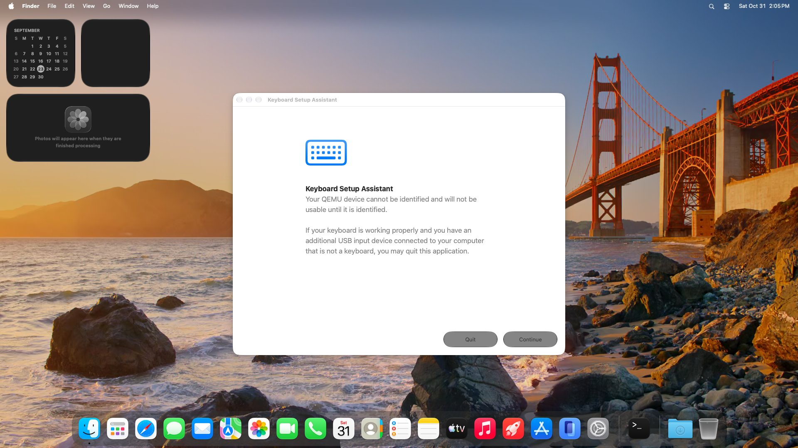
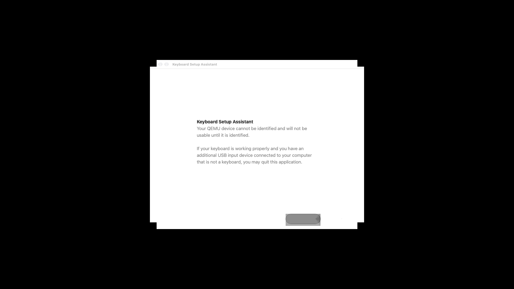
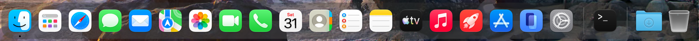

# GoldenGate-VM

macOS 27 "Golden Gate" (build 26A428, arm64) booting to the desktop on an **x86-64 Windows PC**:
QEMU/TCG emulating Apple's `vmapple` virtual machine inside WSL2, with a ParavirtualizedGraphics
host (reims-vgpu) that turns the guest's Metal work into Vulkan, running on Mesa's Dozen
(Vulkan on D3D12) and from there on the real GPU.



It is slow (every arm64 instruction is translated; the desktop appears after ~20-25 minutes) and
incomplete (Liquid Glass has no blur yet, mouse input is not validated). See
[docs/STATUS.md](docs/STATUS.md) and [docs/ARCHITECTURE.md](docs/ARCHITECTURE.md).

This repository holds the scripts, the guest provisioning and the protocol notes. The emulator and
GPU code live in two submodules:

| Path | Fork | Upstream |
|---|---|---|
| `external/orchard` | [JeanxPereira/orchard](https://github.com/JeanxPereira/orchard) `gg-macos27` | [yaelliethy/orchard](https://github.com/yaelliethy/orchard) (QEMU `vmapple` + reims-vgpu) |
| `external/metal2vulkan` | [JeanxPereira/metal2vulkan](https://github.com/JeanxPereira/metal2vulkan) `gg-macos27` | [steelbrain/metal2vulkan](https://github.com/steelbrain/metal2vulkan) (AIR → SPIR-V) |

Pinned commits: [external/PINNED](external/PINNED).

## Tested hardware

| | |
|---|---|
| CPU | AMD Ryzen 7 5700X (8 cores / 16 threads) |
| RAM | 16 GB (WSL gets 11 GB, the guest 6 GB) |
| GPU | AMD Radeon RX 6750 XT (any D3D12 GPU that WSL exposes should do; NVIDIA is untested) |
| OS | Windows 11, WSL2 with WSLg, Ubuntu 24.04 |
| Disk | ~45 GB free on a fast (NVMe) drive for the image, plus ~15 GB for the build |

## Requirements

- Windows 11 with WSL2 and WSLg, an Ubuntu 24.04 distro, and a GPU driver with WSL (D3D12) support.
- A `.wslconfig` that leaves Windows some memory, e.g.

  ```ini
  [wsl2]
  memory=11GB
  swap=8GB
  [experimental]
  autoMemoryReclaim=dropCache
  ```

  Core dumps of QEMU are ~8 GB each and WSL copies them to `%TEMP%\wsl-crashes`; `gg` disables
  them for QEMU, and `maxCrashDumpCount=0` under `[wsl2]` disables them for WSL.
- An internet connection to ghcr.io for the macOS image (~33 GB), crates.io for the Rust build,
  and Launchpad for the Mesa packages.

## Setup

All commands run **inside WSL** unless marked otherwise.

### 1. Data disk (optional, recommended)

Keep the image and the build on WSL's ext4, never under `/mnt/c` and friends. If the distro's own
disk is slow or small, create a dedicated VHDX on an NVMe drive, from an **elevated PowerShell**:

```powershell
powershell -ExecutionPolicy Bypass -File \\wsl$\Ubuntu\home\<you>\GoldenGate-VM\tools\setup-data-vhd.ps1 -SizeGB 70
```

By default the VHDX goes to `%SystemDrive%\WSL\gg-data.vhdx`; pass `-Vhd <drive>:\path\gg-data.vhdx`
to put it on another drive. It formats the VHDX ext4, mounts it at `/mnt/wsl/ggdata` and registers a logon task
`GG mount data disk` that re-mounts it (after `wsl --shutdown`, run
`Start-ScheduledTask 'GG mount data disk'`). Then, in WSL:

```sh
mkdir -p /mnt/wsl/ggdata/gg && ln -s /mnt/wsl/ggdata/gg ~/gg    # GG_HOME defaults to ~/gg
```

### 2. Clone and build

```sh
git clone --recurse-submodules https://github.com/JeanxPereira/GoldenGate-VM.git ~/GoldenGate-VM
cd ~/GoldenGate-VM
./setup.sh
```

`setup.sh` is idempotent. It installs the apt packages (QEMU build deps including
`libgnutls28-dev`/`nettle-dev`, without which the vmapple AES device fails and the guest hangs;
`spirv-tools glslc llvm`, which the shader path calls), checks for Rust (install it with
[rustup](https://rustup.rs) if missing), checks out the submodules, creates a Python venv and an
SSH key in `~/gg`, and builds Orchard with `external/orchard/scripts/build.sh --enable-gnutls`.
It ends with a list of what is left.

### 3. Private Mesa (Dozen)

QEMU runs on Dozen from **kisak-mesa 26.2.5** (LLVM 21.1.8), extracted into a private prefix so the
system Mesa and apt stay untouched. This repository does not ship it. From the PPA
<https://launchpad.net/~kisak/+archive/ubuntu/kisak-mesa> (noble, amd64) download the `.deb` files
of `mesa-vulkan-drivers`, `libllvm21`, `libdrm2` and `libdisplay-info1` into a directory, then:

```sh
tools/mesa-prefix.sh ~/Downloads/kisak-debs        # -> ~/gg/opt/mesa-kisak/{dzn,lvp}_icd.json
```

### 4. apfs-fuse

Needed once, to copy Apple's VM firmware (AVPBooter) out of the image. Build it from
<https://github.com/sgan81/apfs-fuse> (`setup.sh` prints the commands).

### 5. Fetch the macOS image

```sh
tools/prepare-image.sh
```

You download macOS yourself, from the public `cirruslabs/macos-golden-gate-vanilla:27.0` image
on ghcr.io (Cirrus Labs' `tart` images). The script uses Orchard's `fetch-tart-image.py` (resumable,
8 parallel jobs), converts the ASIF disk to a sparse raw image with `tools/asif2raw.py`, keeps the
published NVRAM (aux) and config, extracts `AVPBooter.vmapple2.bin` from the image and patches it
(`tools/find_avpbooter_patch.py --write`; the patch is NyanSatan's, at 0x2370 on this build).
Everything lands in `~/gg/img/gg27/`.

### 6. Provision the guest (once)

```sh
tools/gg provision          # single-user boot, writes the config into a new layer (~3 min)
tools/gg provision finish   # rerun until it says the layer is sealed (first boot: 6-10 min)
```

The layer (`configured.qcow2`) disables Spotlight and `triald`, installs your SSH key for `root`
and `admin`, and adds a telemetry daemon that prints `GGTEL` lines on the serial every minute.
Provisioning keeps the GPU driver down (`REIMS_VGPU_PROTOCOL_CAP=4`).

### 7. Boot

```sh
GG_WINDOW=1 REIMS_VGPU_PROTOCOL_CAP=237 tools/gg verbose
```

`gg verbose` injects `-v serial=3 debug=0x14c` at the iBoot→XNU handoff and boots normally;
237 is also its default protocol cap. `GG_WINDOW=1` opens the screen in a WSLg window (closing it
powers the VM off). Without it the VM is headless; grab the screen with
`tools/gg hmp 'screendump /tmp/screen.ppm'`.

Expected timings on the tested machine: kernel and userspace within a minute, Keyboard Setup
Assistant at ~15 min, Dock and wallpaper at ~20-25 min, widgets at ~30 min, SSH at ~30-35 min.

## Daily use

| Command | What it does |
|---|---|
| `gg verbose` | normal boot, kernel/launchd log and `GGTEL` on the serial |
| `gg single` | single-user root shell on the serial with Data mounted; run commands with `tools/gsh '<cmd>'` |
| `gg up [--fresh] [--paused] [--window]` | plain boot without boot-args |
| `gg st` | status: QEMU, vCPU PCs, serial tail |
| `gg serial [n]` / `gg con` | serial log tail / interactive serial |
| `gg ssh [cmd]` | SSH as `admin` (`GG_USER=root` for root) |
| `gg hmp '<cmd>'` | QEMU monitor command |
| `gg stop` | stop QEMU |
| `gg winprobe` | check that WSLg still maps new windows |
| `gg df` / `gg gc` | disk usage / drop caches and logs |

The root overlay is thrown away on every boot (`GG_KEEP=1` keeps it). Environment knobs:
`GG_HOME` (`~/gg`), `GG_IMG` (`gg27`), `GG_SRC` (`external/orchard/qemu`), `GG_VK`
(`dzn-kisak`, `lvp-kisak`, `system`), `GG_MESA`, `RAM` (`6G`), `CPUS` (`12`).
The host GPU log is `/tmp/reims-vgpu-fail.log`; `tools/gpu-score.sh` summarises it.

From Git Bash on Windows, `tools/w '<command line>'` runs a command in the distro (`GG_DISTRO`,
default `Ubuntu`).

## Screenshots

| | |
|---|---|
|  |  |
| First window drawn through Dozen, before the protocol work | The Dock (glass plate without blur yet) |

## Repository layout

```
setup.sh                host setup (apt, submodules, venv, SSH key, build)
tools/gg                the VM driver (boot, provision, ssh, serial, monitor)
tools/gsh               run a command on the single-user serial shell
tools/prepare-image.sh  fetch + convert the macOS image, extract and patch AVPBooter
tools/mesa-prefix.sh    build the private Mesa prefix from downloaded .debs
tools/27on86/           boot-args injection at the iBoot->XNU handoff (gdb), serial helper
tools/asif2raw.py       Apple Sparse Image Format -> raw
tools/find_avpbooter_patch.py   locate (and with --write, apply) the AVPBooter patch
tools/gpu-score.sh, tools/spirv/triage.sh   host log and SPIR-V dump triage
tools/shaderlab/names   repro of a Dozen crash on long SPIR-V debug names
tools/setup-data-vhd.ps1, tools/w           Windows-side helpers
guest/                  telemetry daemon installed by `gg provision`
docs/                   architecture, status, protocol audits (docs/audit)
external/               submodules (Orchard, metal2vulkan) and PINNED
```

## Credits

- **[Orchard](https://github.com/yaelliethy/orchard)** by Youssef Elliethy (yaelliethy): QEMU
  `vmapple` on TCG, the tart image fetcher, AVPBooter extraction, and the integration of
  reims-vgpu into QEMU. This project is built on it.
- **[reims-vgpu](https://github.com/steelbrain/reims-vgpu)** and
  **[metal2vulkan](https://github.com/steelbrain/metal2vulkan)** by steelbrain: the
  ParavirtualizedGraphics host and the AIR → SPIR-V translator. steelbrain's
  [27on86 experiment](https://github.com/steelbrain/experiment-macOS-arm64-on-linux-x86) is where
  the boot-args injection and serial helpers in `tools/27on86/` come from.
- **[Inferno](https://github.com/ChefKissInc/Inferno)** by ChefKissInc: Orchard's earlier Apple PAC
  emulation was derived from it (see Orchard's `ATTRIBUTION.md`).
- **NyanSatan**, [Virtual-iBoot-Fun](https://github.com/NyanSatan/Virtual-iBoot-Fun): the AVPBooter
  patch.
- **[asif-format](https://github.com/huven/asif-format)** by huven: the ASIF layout `asif2raw.py`
  follows. **[apfs-fuse](https://github.com/sgan81/apfs-fuse)** by sgan81.
- **Cirrus Labs** for publishing the `tart` macOS images; **Mesa** (Dozen) and the kisak PPA.
- QEMU's `vmapple` machine by Alexander Graf and contributors.

## Legal

No Apple software is distributed here: no macOS image, firmware, kernelcache or framework. You
fetch the macOS image yourself and extract the firmware from it on your own machine, under the
licence terms that apply to it (macOS licences restrict virtualisation to Apple hardware; reading
and complying with them is your responsibility). The audit documents describe the behaviour of
Apple binaries by function name and address for interoperability; they contain no Apple code.
This project is not affiliated with or endorsed by Apple. "macOS" and "Metal" are trademarks of
Apple Inc.

Licence: GPL-2.0-or-later for this repository; the submodules carry their own licences. See
[LICENSE](LICENSE) and [NOTICE](NOTICE).

## Em português

GoldenGate-VM roda o macOS 27 (26A428, arm64) num PC x86-64 com Windows 11: QEMU/TCG emulando a
máquina `vmapple` dentro do WSL2, com a GPU paravirtual (reims-vgpu) traduzindo o Metal do guest
pra Vulkan no Dozen (D3D12). O desktop aparece em ~20-25 min num Ryzen 7 5700X com RX 6750 XT;
o vidro do Liquid Glass ainda não tem desfoque e o mouse não foi validado. Siga a seção *Setup*
acima (tudo dentro do WSL): `./setup.sh`, Mesa privado com `tools/mesa-prefix.sh`,
`tools/prepare-image.sh` (você mesmo baixa a imagem do macOS), `gg provision`,
`gg provision finish` e por fim `GG_WINDOW=1 gg verbose`. Nenhum software da Apple é distribuído
aqui.
